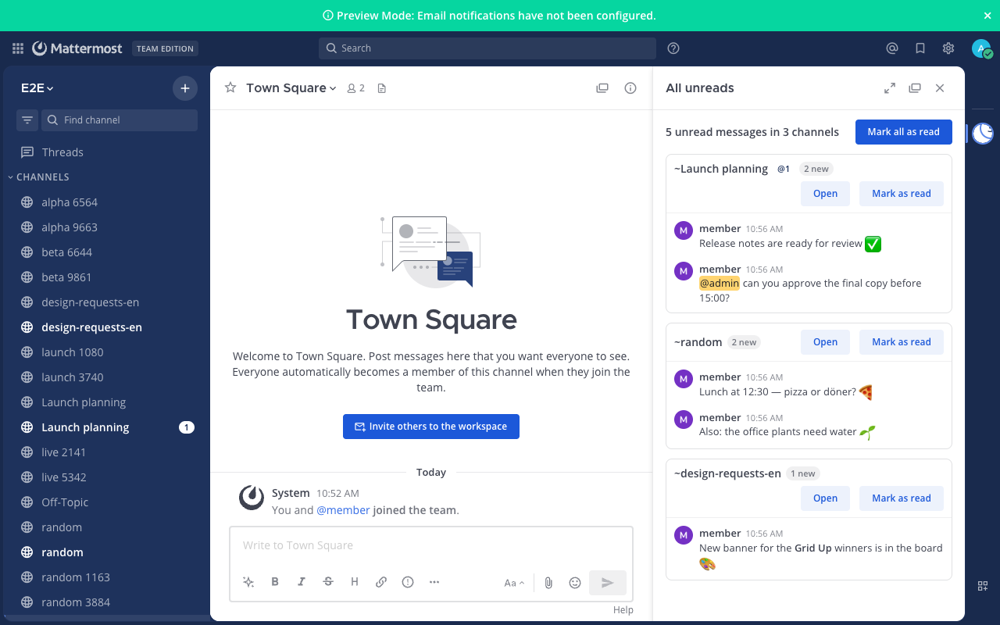

# All Unreads for Mattermost

One panel with every unread message across your channels — read them in place and mark them
read, channel by channel or all at once. Like Slack's **All Unreads**.



## Features

- **📥 All unreads** icon in the app bar (the channel header on older layouts), with the number
  of unread channels, highlighted when someone mentioned you.

  

- **One list, grouped by channel**: each unread channel shows its name, how many new messages it
  has, your mentions, and the messages themselves (sender, time, text rendered like in
  Mattermost: mentions, emoji, links, formatting). Channels where you were mentioned come first,
  then the most recently active.
- **Open** jumps to the first unread message (which also marks the channel read, as usual);
  **Mark as read** clears one channel; **Mark all as read** clears everything after a quick
  "are you sure?".
- **Unread threads** (with collapsed reply threads on) appear as one line with a shortcut to the
  Threads view, where Mattermost already lets you read and mark them.
- **Live**: new messages appear in the panel as they arrive, and channels you read elsewhere drop
  out on their own.
- **Exactly what the sidebar shows**: unread counts use the same rules as Mattermost's sidebar —
  root posts only when collapsed threads are on, and muted channels only when you were
  mentioned. Covers the current team plus direct and group messages.

## Install

Requires Mattermost **10.11** or later. Tested on **11.7** and **12.0** with the same build.

1. Download `dev.patika.all-unreads-<version>.tar.gz` from the
   [latest all-unreads release](https://github.com/PatikaDev/mattermost-plugins/releases?q=all-unreads&expanded=true)
   (`SHA256SUMS` is attached for verification).
2. **System Console → Plugins → Plugin Management → Upload Plugin**, choose the file, then
   **Enable**. Plugin uploads must be allowed (`PluginSettings.EnableUploads`).

Or with `mmctl`:

```bash
mmctl plugin add dev.patika.all-unreads-<version>.tar.gz
mmctl plugin enable dev.patika.all-unreads
```

Users may need to reload the app (Ctrl/Cmd + R) once to see the icon. There is nothing to
configure.

### Good to know

- Each channel shows its latest 5 unread messages, with a link to open the channel for the rest.
- Mobile apps don't show plugin panels; on phones, Mattermost's own unread filter (the filter
  icon above the channel list) is the closest thing.
- Built-in helpers worth knowing alongside it: **⌘/Ctrl + Shift + U** toggles an unread-only
  channel list, and **Settings → Sidebar → Group unread channels separately** keeps unread
  channels at the top.

## How it works

The plugin has no server component. It reads the unread counts your Mattermost web or desktop
app already has, loads the latest messages of unread channels with the same API the app uses
(so it only ever shows messages you can already see), and marks channels read with Mattermost's
own `mark_read` endpoint — the one behind the sidebar's "Mark as read".

## Privacy

Nothing leaves your Mattermost server and nothing is stored by the plugin: it shows data your
app already has access to, in your browser.

## Development

Requirements: Node 24.21.0 (see `../../.node-version`), Go (see `go.mod`, used by the build tooling
only), Docker for the end-to-end tests.

```bash
cd webapp && npm ci
npm run lint && npm run check-types && npm test    # unit tests
cd .. && make dist                                 # → dist/dev.patika.all-unreads-<version>.tar.gz
```

End-to-end tests drive real Chrome against a throwaway Mattermost in Docker:

```bash
cd e2e && npm ci && npx playwright install chrome
MM_VERSION=11.7.11 ./scripts/start-server.sh       # or 12.0.0, …
npx playwright test
npm run server:stop
```

The plugin is built to run unchanged on React 17, 18 and 19 (the server's own React is used at
runtime). See [CONTRIBUTING.md](CONTRIBUTING.md). Releases are cut by pushing a `v*` tag; CI
builds the plugin and attaches it to a GitHub Release.

## License

[Apache License 2.0](../../LICENSE). Built on the
[Mattermost plugin starter template](https://github.com/mattermost/mattermost-plugin-starter-template)
— see [NOTICE](../../NOTICE). Made by [Patika](https://patika.dev).
