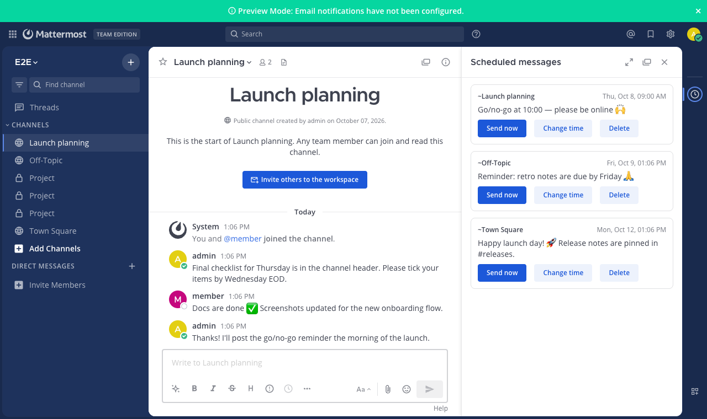
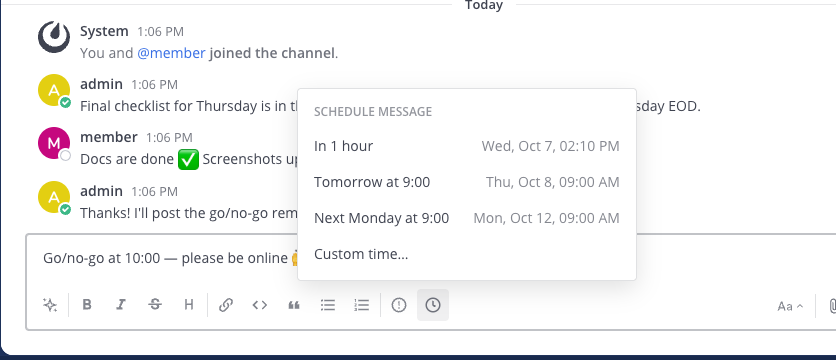
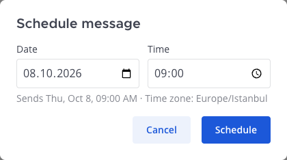
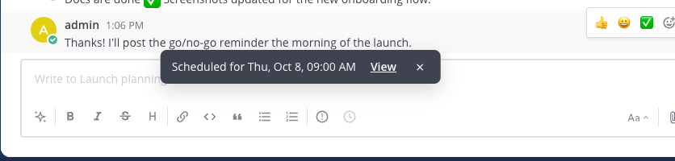

# Scheduled Messages for Mattermost

Write a message now, send it later. Schedule posts — with attachments — in channels, direct
messages, group messages and thread replies, straight from the message box. Works on
Mattermost **Team Edition** and every other edition.



## Features

- **🕘 Clock button in every message box** — the channel box and thread replies. Pick
  **In 1 hour**, **Tomorrow at 9:00**, **Next Monday at 9:00**, or **Custom time…**. The box is
  cleared and a short "Scheduled for …" note appears, with a link to the queue.
- **Attachments too:** files you've added to the message box go out with the message.
- **Sent as you**, in the same channel or thread, as if you had pressed Enter at that moment —
  mentions and notifications work normally.
- **Scheduled messages panel** (clock icon in the app bar / channel header): every message
  you have queued, across all channels, with **Send now**, **Change time** and **Delete**.
- **Your time zone:** times are picked and shown in the time zone from your Mattermost profile
  (*Settings → Display → Timezone*), in 12- or 24-hour format as you've set it.
- **Safe when things change:** just before sending, the plugin checks again that you can still
  post there (not removed from the channel, channel not archived, thread not deleted). If not,
  the message isn't posted; it's kept in your panel as **failed**, and the *Scheduled Messages*
  bot sends you a direct message with the reason and your text, so nothing is lost.
- **Live everywhere:** the panel updates in all your open tabs and devices when a message is
  sent, rescheduled or fails.

| Pick a time | Custom time | Confirmation |
|---|---|---|
|  |  |  |

## Why a plugin?

Mattermost has built-in message scheduling, but only on licensed editions (Professional and
above). This plugin brings it to Team Edition, and works the same on any edition.

## Install

Requires Mattermost **10.11** or later. Tested on **11.7** and **12.0** with the same build.

1. Download `dev.patika.scheduled-messages-<version>.tar.gz` from the
   [latest scheduled-messages release](https://github.com/PatikaDev/mattermost-plugins/releases?q=scheduled-messages&expanded=true)
   (`SHA256SUMS` is attached for verification).
2. **System Console → Plugins → Plugin Management → Upload Plugin**, choose the file, then
   **Enable**. Plugin uploads must be allowed (`PluginSettings.EnableUploads`).

Or with `mmctl`:

```bash
mmctl plugin add dev.patika.scheduled-messages-<version>.tar.gz
mmctl plugin enable dev.patika.scheduled-messages
```

Users may need to reload the app (Ctrl/Cmd + R) to see the clock button. There is nothing to
configure.

## Using it

1. Write your message (and attach files if you like) in a channel, DM or thread reply.
2. Click the **clock** next to the formatting buttons and pick a time — or **Custom time…** for
   any date and time up to a year ahead.
3. To see, send early, reschedule or delete your queued messages, click **View** in the
   confirmation or the **clock icon** in the app bar.

### Good to know

- Messages are sent by a job that runs **once a minute**, so they go out within a minute of
  the chosen time. If the server is down at that moment, they go out as soon as it is back.
- Limits: up to **200** queued messages per person, **10** attachments per message, at least
  **30 seconds** and at most **one year** ahead.
- Scheduled messages are private to their author — nobody else, admins included, sees them in
  the panel.
- Scheduled posts carry Mattermost's standard `from_plugin` flag in their metadata; they look
  and behave like any other post from you.
- Mobile apps don't show plugin buttons, so scheduling is done from the web or desktop app;
  the messages themselves arrive on every device as usual.

## How it works

The webapp part adds the button, the panel and the dialogs. The server part stores each
scheduled message in the plugin's key-value store, and a cluster-safe job sends due messages
once a minute through Mattermost's plugin API, as the author. Each message is claimed with a
compare-and-set before sending, so it is posted at most once even with several app servers.
If a send is interrupted and the plugin can't tell whether it went out, the message is marked
failed with a note rather than risking a duplicate.

Attachments are the files you uploaded to the message box; they stay unattached on the server
until the message is sent, exactly as with a draft.

## Privacy

Scheduled messages and their attachments are stored on your own Mattermost server (the
plugin's key-value store and normal file storage). The plugin sends nothing anywhere else.

## Development

Requirements: Node 24.21.0 (see `.node-version`), Go (see `go.mod`), Docker for the
end-to-end tests.

```bash
go test -race ./server/...                         # server unit tests
cd webapp && npm ci
npm run lint && npm run check-types && npm test    # webapp unit tests
cd .. && make dist                                 # → dist/dev.patika.scheduled-messages-<version>.tar.gz
```

End-to-end tests drive real Chrome against a throwaway Mattermost in Docker and wait for the
real minute job (about 3 minutes in total):

```bash
cd e2e && npm ci && npx playwright install chrome
MM_VERSION=11.7.11 ./scripts/start-server.sh       # or 12.0.0, …
npx playwright test
npm run server:stop
```

The webapp is built to run unchanged on React 17, 18 and 19 (the server's own React is used at
runtime). See [CONTRIBUTING.md](CONTRIBUTING.md).

Releases are cut by pushing a `v*` tag; CI builds the plugin and attaches it to a GitHub
Release.

## License

[Apache License 2.0](LICENSE). Built on the
[Mattermost plugin starter template](https://github.com/mattermost/mattermost-plugin-starter-template)
— see [NOTICE](NOTICE). Made by [Patika](https://patika.dev).
